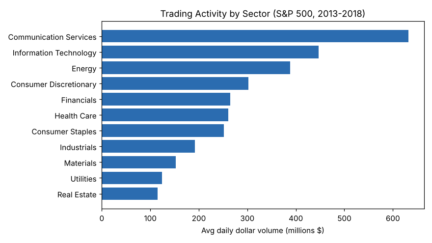
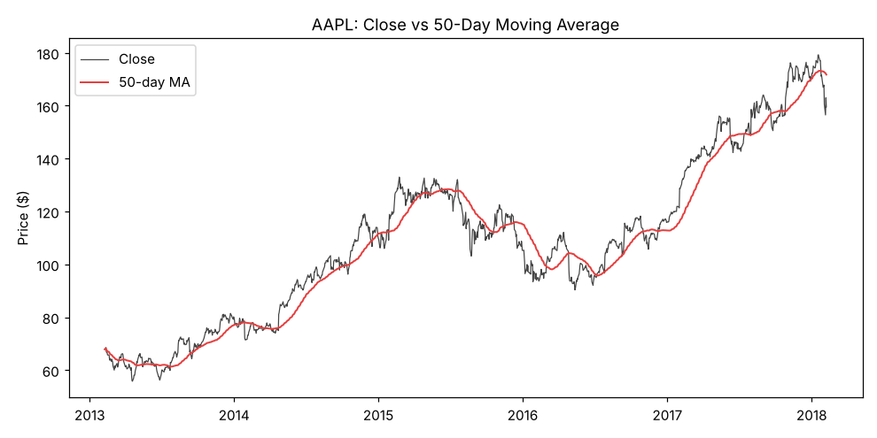
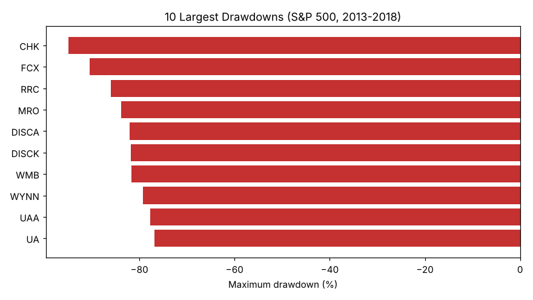

# S&P 500 Market Analysis in SQL

A SQL analytics project exploring **liquidity, volatility, and risk** across the
S&P 500 using five years of daily price data (Feb 2013 – Feb 2018). Built with
**DuckDB**; every result below is produced by the queries in
[`queries.sql`](queries.sql).

## Dataset & Schema

Two source tables (see [`data/`](data/)), joined on ticker `symbol`:

| Table | Grain | Key columns |
|---|---|---|
| `daily_prices` | one row per stock per trading day (619,040 rows, 505 stocks) | `trade_date, symbol, open, high, low, close, volume` |
| `companies` | one row per current S&P 500 member (503 rows) | `symbol, name, sector, sub_industry, hq, date_added` |

Sources: daily OHLCV from the Kaggle *S&P 500 (5-year)* dataset; constituents
from the `datasets/s-and-p-500-companies` repository.

## How to run

```bash
pip install duckdb matplotlib
python build_db.py          # builds sp500.duckdb from the two CSVs
duckdb sp500.duckdb         # then paste any query from queries.sql
```

## The analysis — 12 questions

| # | Business question | SQL technique | Key finding |
|---|---|---|---|
| 1 | What does the data cover? | `COUNT`, `MIN/MAX` | 619k rows, 505 stocks, 2013–2018 |
| 2 | Which sectors trade the most money per day? | `JOIN`, `GROUP BY` | Communication Services, IT, Energy lead |
| 3 | Most actively traded stocks? | `RANK()` window + CTE | ranked by avg daily share volume |
| 4 | Largest single-day price jumps? | `LAG()` for daily returns | flags real events **and** data errors (see notes) |
| 5 | Most volatile stocks? | `STDDEV` × √252 annualization | annualized vol per stock, by sector |
| 6 | 50-day moving-average crosses for AAPL | windowed moving avg + `CASE` | dates of bullish/bearish crossovers |
| 7 | Worst peak-to-trough drawdowns? | running `MAX` window | CHK −95%, FCX −90% (2014–16 oil crash) |
| 8 | Best-performing sectors over 5 years? | `FIRST/LAST_VALUE` + `JOIN` | total return by sector |
| 9 | Which sectors are least liquid? | Amihud illiquidity measure | `|return| / dollar volume` by sector |
| 10 | Do volume spikes mean bigger moves? | trailing-window avg + `CASE` | **spike days move 3× more: 2.98% vs 0.99%** |
| 11 | How correlated are AAPL and MSFT? | monthly returns + `CORR` | monthly-return correlation ≈ 0.32 |
| 12 | Which tickers left the index since 2018? | `LEFT JOIN` anti-join | set logic / data reconciliation |

## Selected charts





## Data-quality notes

Q4 surfaces a few implausible one-day "returns" (e.g. a +101% print). These are
not real market moves but **unadjusted stock splits or bad ticks** in the raw
feed. Flagging and setting them aside, rather than reporting them as findings, is
part of the analysis — the same diagnostic discipline I apply in my econometrics
research.

## Skills demonstrated

Joins across a relational schema · aggregation · window functions (`RANK`,
`LAG`, `FIRST/LAST_VALUE`, running max, moving averages, trailing frames) · CTEs ·
`CASE` logic · date handling · correlation · and finance-specific measures
(daily/annualized volatility, maximum drawdown, Amihud illiquidity).
